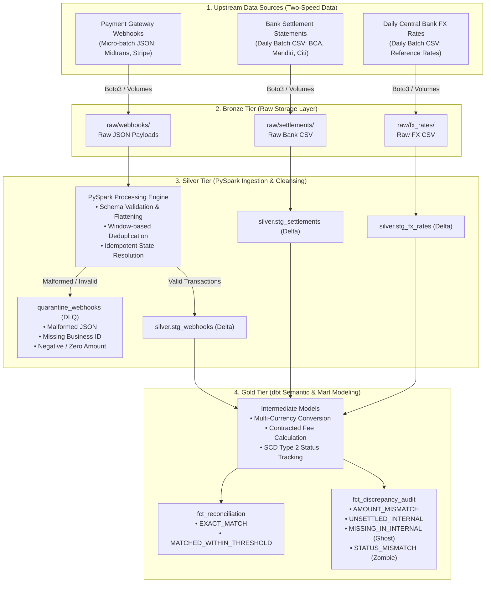

# Cross-Border Payment Gateway & Settlement Reconciliation Engine

[](.github/workflows/ci.yml)
[](pyproject.toml)
[](src/payment_recon/spark_session.py)
[](https://delta.io/)
[](dbt_recon/)
[](docker-compose.yml)
[](airflow/)
[](https://github.com/astral-sh/ruff)
[](https://github.com/python-semantic-release/python-semantic-release)
[](LICENSE)

An enterprise-grade, dual-speed **Data Lakehouse & Financial Reconciliation Engine** designed to match high-velocity, micro-batch payment gateway webhooks against daily multi-currency bank settlement mutations. Built with **PySpark**, **Delta Lake**, **dbt**, and **Apache Airflow**, adhering to a **Hybrid Dual-Environment Parity** pattern (Local MinIO TDD ↔ Databricks Unity Catalog Cloud).

---

## 1. Executive Summary & Problem Statement

In modern fintech and cross-border e-commerce platforms, payment reconciliation is vulnerable to financial leakage, operational blind spots, and ledger inconsistencies:

* **Two-Speed Data Asymmetry:** Internal systems process real-time, asynchronous webhook events (`raw_webhooks`) with nested retry attempts, out-of-order deliveries, and customer retries. Conversely, acquiring partner banks produce daily batch settlement clearing reports (`raw_bank_settlements`) after deducting merchant discount rates (MDR).
* **Multi-Currency FX Volatility:** International transactions (USD, SGD, EUR) settled in local currency (IDR) experience foreign exchange (FX) market slippage between the customer authorization timestamp and the bank settlement clearing window.
* **Complex Discrepancy Topology:** Systems must systematically detect and isolate ghost payments, zombie charges, merchant fee variance, and late-clearing bank statements without mutating financial ledgers.

This engine automates end-to-end ingestion, schema enforcement, deduplication, Dead-Letter Queue (DLQ) quarantine, and multi-currency tolerance reconciliation within a Lakehouse Medallion Architecture.

---

## 2. End-to-End Architecture



### Medallion Tier Responsibilities

| Tier | Format / Target | Engine | Core Responsibilities |
| :--- | :--- | :--- | :--- |
| **Bronze** | Raw JSON / CSV in Object Storage | Python / Boto3 / Databricks SDK | Immutable raw payload archive partitioned by ingestion timestamp. Zero data transformation. |
| **Silver** | Delta Lake ACID Tables | PySpark 4.2 | Nested JSON struct flattening, schema contract enforcement, Dead-Letter Queue (DLQ) segregation, windowed state deduplication. |
| **Gold** | Dimensional Star Schema Marts | dbt-core / dbt-databricks | Financial reconciliation logic, daily exchange rate conversion, dynamic tolerance verification, SCD Type 2 state tracking, discrepancy auditing. |

---

## 3. Hybrid Dual-Environment Parity (Local ↔ Cloud)

A core engineering principle of this repository is **Environment Parity**: the exact same PySpark extraction jobs and dbt models execute across both environments via a single runtime switch (`ENV_MODE`):

```text
               ┌────────────────────────────────────────────────────────┐
               │                Single Codebase (Python)                │
               │         payment_recon.config & spark_session           │
               └───────────────────────────┬────────────────────────────┘
                                           │
                 ┌─────────────────────────┴─────────────────────────┐
                 ▼                                                   ▼
     [ ENV_MODE = local ]                               [ ENV_MODE = databricks ]
┌─────────────────────────────────────┐             ┌─────────────────────────────────────┐
│ • MinIO S3 Object Storage Container │             │ • Databricks Unity Catalog Volumes  │
│ • Local PySpark + Delta Lake        │             │ • Databricks Serverless / Cluster   │
│ • Zero Cloud Cost Development / TDD │             │ • Managed Delta Tables in UC        │
│ • Isolated GitHub Actions CI Runner │             │ • Production Cloud Staging Showcase │
└─────────────────────────────────────┘             └─────────────────────────────────────┘
```

* **Local Mode (`ENV_MODE=local`):** Uses an S3A connector targeting a local MinIO container (`s3a://payment-recon/...`). Ideal for lightning-fast unit testing, offline development, and zero-cost CI/CD execution.
* **Databricks Cloud Mode (`ENV_MODE=databricks`):** Automatically maps storage paths to Databricks Unity Catalog Volumes (`/Volumes/main/payment_recon/...`) using native cluster Spark sessions.

---

## 4. Data Contracts & Upstream Validation Rules

### A. Fast-Path: Webhook JSON Contract (`raw_webhooks`)
Captures asynchronous micro-batch gateway events. Nested structure enforces strict constraints:

| JSON Path | Data Type | Nullable | Description & Invariant |
| :--- | :--- | :---: | :--- |
| `event_id` | String | No | Unique event payload ID (`evt_<alphanumeric>`). Used for transport deduplication. |
| `timestamp` | Timestamp (ISO8601) | No | Receipt timestamp in UTC. |
| `event.status` | String | No | Allowed: `pending`, `success`, `failed`, `cancelled`. |
| `transaction.transaction_id` | String | No | Canonical business entity key (`trx_<alphanumeric>`). |
| `transaction.amount` | Decimal(18, 2) | No | Gross transaction nominal. **Constraint:** Must be strictly positive (> 0). |
| `transaction.currency` | String (ISO 4217) | No | Source currency: `USD`, `SGD`, `EUR`, `IDR`. |
| `transaction.attempts` | Array[Struct] | Yes | Historical payment attempts before reaching final status. |
| `payment_gateway_response.status_code` | String | No | HTTP status code response (e.g. `200`, `400`). |
| `trace.trace_id` | String | No | Distributed tracing ID for end-to-end observability. |

### B. Slow-Path: Bank Settlement CSV Contract (`raw_bank_settlements`)
Represents daily clearing statements received from partner bank accounts:

| CSV Column | Target Type | Nullable | Description & Invariant |
| :--- | :--- | :---: | :--- |
| `settlement_id` | String | No | Bank settlement transaction primary key (`stl_<alphanumeric>`). |
| `transaction_id` | String | No | Foreign key linking to internal `transaction.transaction_id`. |
| `transaction_date` | Date | No | Origin transaction date according to bank records. |
| `settlement_date` | Date | No | Clearing settlement date when funds reached the corporate account. |
| `gross_amount` | Decimal(18, 2) | No | Gross amount converted into destination currency (IDR). |
| `fee_amount` | Decimal(18, 2) | No | Acquirer / MDR processing fee deducted by bank. |
| `net_settled_amount` | Decimal(18, 2) | No | Net transferred funds (`gross_amount - fee_amount`). |
| `settlement_currency` | String (ISO 4217) | No | Destination clearing currency (Standard: `IDR`). |
| `applied_fx_rate` | Decimal(12, 4) | No | Effective exchange rate applied by acquirer during liquidation. |
| `bank_name` | String | No | Partner banking institution (`BCA`, `MANDIRI`, `CITI`, etc.). |

---

## 5. Upstream Data Hygiene & Silver Processing (PySpark)

### Dead-Letter Queue (DLQ) Quarantine Policy
Malformed or fraudulent records are diverted to `silver.quarantine_webhooks` with an explicit `rejection_reason`:
1. **Malformed Structure:** Payload fails JSON schema validation or parsing.
2. **Missing Business Identity:** Record lacks `transaction.transaction_id` or contains empty strings.
3. **Invalid Monetary Value:** `transaction.amount` is `NULL` or non-positive (≤ 0).
4. **Missing Temporal Timestamp:** Null or corrupted `timestamp`.

### Idempotency & Deduplication Strategy
1. **Exact Transport Delivery Duplicates:** Discard redundant payloads sharing identical `event_id`:
   ```python
   df_deduped_events = df_raw.dropDuplicates(["event_id"])
   ```
2. **State Evolution Resolution:** Multiple status events for a single `transaction_id` (e.g. `pending` → `success`) are resolved by keeping only the latest authoritative state using distributed window ranking:
   ```sql
   ROW_NUMBER() OVER (PARTITION BY transaction_id ORDER BY timestamp DESC)
   ```

---

## 6. Financial Reconciliation Logic & Classification (dbt Gold)

### Mathematical Formulation
For each successful transaction, the reconciliation model evaluates the **Expected Net Amount**:

$$\text{Expected Gross IDR} = \text{Original Amount} \times \text{Exchange Rate}$$

$$\text{Expected Net IDR} = \text{Expected Gross IDR} - \text{Contracted Fee}$$

$$\text{Variance IDR} = |\text{Expected Net IDR} - \text{Net Settled Amount}|$$

$$\text{Variance Percentage} = \frac{\text{Variance IDR}}{\text{Expected Net IDR}} \times 100$$

### Dynamic Reconciliation Tolerance
* **Domestic Transactions (`IDR` → `IDR`):**
  Tolerance threshold: **≤ 0.05%** or absolute nominal discrepancy ≤ Rp 100 (rounding allowance).
* **Cross-Border Transactions (`USD` / `SGD` / `EUR` → `IDR`):**
  Tolerance threshold: **≤ 1.0%** to accommodate intraday forex rate fluctuation (*FX Slippage*).

### Reconciliation Classification Taxonomy

| Reconciliation Status | Business Condition | Gold Destination Table |
| :--- | :--- | :--- |
| **`EXACT_MATCH`** | Present in internal & bank ledgers; `Variance IDR == 0`. | `fct_reconciliation` |
| **`MATCHED_WITHIN_THRESHOLD`** | Present in both ledgers; `Variance Percentage <= 1.0%`. | `fct_reconciliation` |
| **`AMOUNT_MISMATCH`** | Present in both ledgers, but variance **exceeds tolerance** (> 1.0%). | `fct_discrepancy_audit` |
| **`UNSETTLED_INTERNAL`** | Internal transaction `success`, but missing from bank clearing (≤ 3 days: *Late Arriving*, > 3 days: *Overdue*). | `fct_discrepancy_audit` |
| **`MISSING_IN_INTERNAL`** | Unrecognized money received at bank with unknown internal ID (*Ghost Payment*). | `fct_discrepancy_audit` |
| **`STATUS_MISMATCH`** | Internal ledger records `failed` or `cancelled`, but bank cleared funds (*Zombie Payment*). | `fct_discrepancy_audit` |

---

## 7. Repository Layout

```text
Payment-gateway-Settlement-reconciliation-engine/
├── .github/
│   └── workflows/
│       └── ci.yml                 # Automated Ruff formatting, linting, Pytest, & Semantic Release
├── airflow/
│   └── dags/                      # Airflow orchestration DAGs
├── dbt_recon/                     # dbt analytics transformation project
│   └── models/
│       ├── staging/               # Staging models from Delta Lake
│       ├── intermediate/          # Currency conversion & reconciliation logic
│       └── marts/                 # Star schema marts (fct_reconciliation, fct_discrepancy_audit)
├── docs/
│   └── Data Contract & Business Rules.md # Authoritative data contracts & SLA specifications
├── src/
│   ├── data_gen/                  # Synthetic two-speed data generators with anomalies
│   │   ├── settlement_bank_csv_gen.py # Synthetic bank settlement CSV generator
│   │   └── webhook_json_gen.py        # Synthetic nested webhook JSON generator
│   ├── ingestion/                 # Object storage integration layer
│   │   └── storage_uploader.py    # S3A / MinIO / Databricks Volumes uploader
│   ├── payment_recon/             # Core engine package
│   │   ├── config.py              # Environment switch (local vs databricks) & path resolver
│   │   └── spark_session.py       # SparkSession factory (Delta Lake + MinIO S3A)
│   └── spark_jobs/                # Pure PySpark transformations (Bronze to Silver)
├── tests/                         # Pytest test suite (100% automated CI)
│   ├── test_config.py             # Environment configuration & path resolver tests
│   ├── test_spark_session.py      # SparkSession instantiation & S3A connector tests
│   ├── test_generator/            # Synthetic data generation & anomaly injection tests
│   └── test_ingestion/            # MinIO S3 client & bucket upload tests (Moto mocks)
├── docker-compose.yml             # Local MinIO S3-compatible storage container
├── pyproject.toml                 # uv project configuration, dependencies, and tools
└── README.md                      # Comprehensive project documentation
```

---

## 8. Software Engineering Standards

This project demonstrates production-grade software engineering practices:

* **Test-Driven Development (TDD):** Business rules and edge cases are proven through comprehensive automated unit tests (`pytest`) before implementation.
* **Comment-Driven Development (CDD):** Complex transformation logic is architected with clear pseudo-code invariants prior to implementation.
* **Strict Static Typing:** Utilizes Python 3.13 typing annotations, `TYPE_CHECKING` guards, and official AWS SDK type stubs (`boto3-stubs[s3]`) for full static analysis and IDE autocompletion.
* **NumPy Docstring Standard:** Every function and module is comprehensively documented following the NumPy docstring convention (`Parameters`, `Returns`, `Raises`, `Examples`).
* **Automated CI/CD & Semantic Release:** GitHub Actions enforces strict Ruff linting, code formatting, Java 17 PySpark test execution, and automated semantic versioning (`python-semantic-release`).

---

## 9. Getting Started

### Prerequisites
* **Python >= 3.13** (managed via [`uv`](https://github.com/astral-sh/uv))
* **Java JDK 17** (required for local Apache Spark runtime)
* **Docker & Docker Compose** (for local MinIO S3 object storage)
* **Git**

### Installation & Environment Setup

1. **Clone the repository:**
   ```bash
   git clone https://github.com/hmnty11/Payment-gateway-Settlement-reconciliation-engine.git
   cd Payment-gateway-Settlement-reconciliation-engine
   ```

2. **Install dependencies via `uv`:**
   ```bash
   uv sync --all-groups
   ```

3. **Configure environment variables:**
   ```bash
   cp ".env example" .env
   ```
   *For local development, `.env` contains defaults for MinIO credentials (`ENV_MODE=local`).*

4. **Start local MinIO object storage:**
   ```bash
   docker compose up -d
   ```
   * Access MinIO Web Console: [http://localhost:9001](http://localhost:9001)
   * S3 API Endpoint: `http://localhost:9000`

---

## 10. Running Synthetic Data Generators & Tests

### Generate Synthetic Test Data
Generate sample webhook JSON payloads and bank settlement CSV files injected with synthetic anomalies:

```bash
# Generate synthetic webhook JSON events with 10% anomaly injection
uv run python src/data_gen/webhook_json_gen.py

# Generate synthetic bank settlement CSV records
uv run python src/data_gen/settlement_bank_csv_gen.py
```

### Run Unit Tests
Execute the automated test suite across environment configuration, synthetic generators, S3 ingestion (via Moto), and PySpark session creation:

```bash
# Run all unit tests
uv run pytest -v

# Run non-Spark fast unit tests
uv run pytest tests/test_config.py tests/test_generator tests/test_ingestion
```

### Code Formatting & Linting
Enforce code quality standards with Ruff:

```bash
# Check code style and linting
uv run ruff check .

# Check formatting
uv run ruff format --check .

# Auto-format codebase
uv run ruff format .
```

---

## 11. Project Roadmap & Implementation Status

- [x] **Phase 1: Architecture Blueprint & Dual-Environment Foundations**
  - [x] Define Data Contracts & Business Rules specification (`docs/Data Contract & Business Rules.md`).
  - [x] Dual-environment configuration manager (`payment_recon.config`).
  - [x] SparkSession factory with Delta Lake and MinIO S3A connector (`payment_recon.spark_session`).
  - [x] Automated CI workflow with Java 17, Ruff, and Pytest.
- [x] **Phase 2: Synthetic Data Engine & Ingestion Tier**
  - [x] Nested webhook JSON generator with configurable anomaly rates (`webhook_json_gen.py`).
  - [x] Bank settlement CSV generator with FX conversion and MDR fee modeling (`settlement_bank_csv_gen.py`).
  - [x] S3-compatible idempotent object storage uploader (`storage_uploader.py`).
  - [x] Moto mock test suite for storage ingestion.
- [ ] **Phase 3: Upstream PySpark Bronze-to-Silver Pipeline (In Progress)**
  - [ ] Pure PySpark JSON schema flattening & type casting (`flatten_webhooks.py`).
  - [ ] Dead-Letter Queue (DLQ) quarantine routing for invalid records.
  - [ ] Windowed state deduplication (`deduplicate_events.py`).
  - [ ] PySpark unit tests using local Spark fixtures.
- [ ] **Phase 4: Downstream dbt Silver-to-Gold Semantic Modeling**
  - [ ] Staging models for Silver Delta tables (`stg_webhooks`, `stg_bank_settlements`).
  - [ ] Multi-currency conversion intermediate layer (`int_fx_converted`).
  - [ ] Reconciliation fact mart (`fct_reconciliation`) and discrepancy audit mart (`fct_discrepancy_audit`).
  - [ ] SCD Type 2 status snapshot tracking (`snap_transaction_status`).
- [ ] **Phase 5: Orchestration, Idempotency & Backfill Proof**
  - [ ] Apache Airflow DAG orchestrating Generator → PySpark Job → `dbt build`.
  - [ ] Idempotency proof: multi-run backfill verification demonstrating zero ledger duplication.

---

## 12. Author & Portfolio

**Darren Jeho**
* GitHub: [@hmnty11](https://github.com/hmnty11)
* Email: [darrenjeho@gmail.com](mailto:darrenjeho@gmail.com)
* Focus: Data Engineering, Distributed Data Systems, Lakehouse Architecture (Spark / Delta / dbt / Airflow)

---

## 13. License

Distributed under the MIT License. See [LICENSE](LICENSE) for more information.
